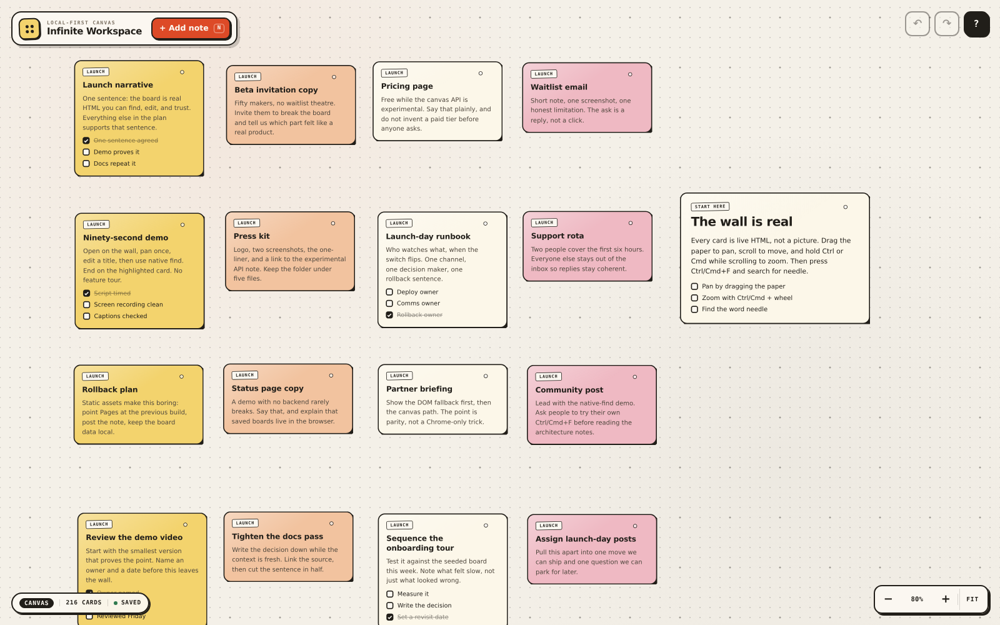
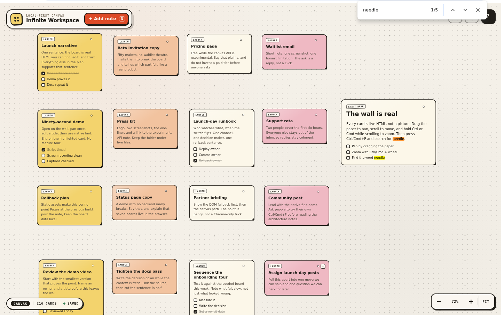
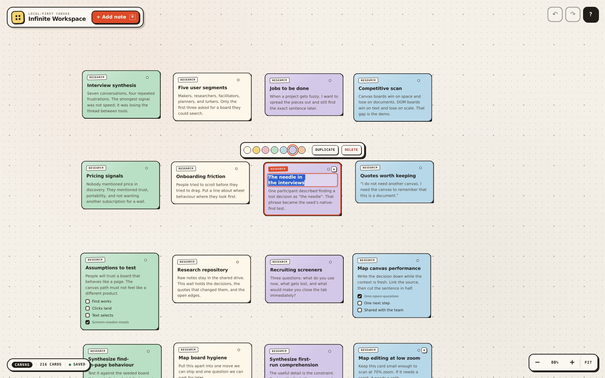

# Infinite Workspace

A Miro-style infinite board whose cards are not painted pixels. Every title, body, checklist, and checkbox is real, live, editable HTML — composited into a `<canvas>` with the experimental [HTML-in-Canvas API](https://github.com/WICG/html-in-canvas), with a complete DOM fallback for browsers that don't support it.

The point is simple: press **Ctrl/Cmd + F**, search for `needle`, and watch the browser's native find-in-page highlight text inside a card. No custom search field. No fake text layer. The browser is searching the same DOM you are editing.

**[Open the live board →](https://gerrcass.github.io/infinite-workspace/)**



## What you can do

- **Pan** by dragging empty paper, scrolling, or using the arrow keys.
- **Zoom** with Ctrl/Cmd + wheel, trackpad pinch, or the zoom controls. Zoom is anchored to the pointer.
- **Edit in place**: click a title, body, or checklist label. Real caret, real selection, native text undo, plain-text paste.
- **Check things off** with real `<input type="checkbox">` controls.
- **Arrange** cards by dragging their top strip; the selected card gets a colour/duplicate/delete toolbar.
- **Add** a card with `N`, **duplicate** with Ctrl/Cmd + D, **delete** with Delete, and **undo** with Ctrl/Cmd + Z.
- **Find** anything with native Ctrl/Cmd + F. The seeded board deliberately hides the word `needle` in a few cards.
- **Reload** and your board and camera come back from local storage. Reset the curated demo from Help.

## Native find, honestly

Chrome's native find bar finds and highlights real text inside the canvas cards — that was verified in headed Chrome 157 against this build. The find bar does not expose its active match to page JavaScript, so the app cannot move its camera to an off-screen native match; pan to the card and the native highlight is there.

The app also listens for non-collapsed `selectionchange` events and reveals the matching card. That path is exercised by `window.find()` and by find implementations that expose a selection. It is tested in both renderers. There is no custom find field and no interception of Ctrl/Cmd + F.



Chrome's own find bar, with 1/5 matches, highlighting real card text inside the canvas. The camera cannot be driven by the browser's find bar, so the app states that limitation instead of replacing it.



A selection-based find (`window.find`) sets a real selection; the app eases the camera to the card and the browser paints the highlight into the canvas snapshot.

## Renderers

| Browser                                               | Renderer   | What happens                                                                                                                                                                                              |
| ----------------------------------------------------- | ---------- | --------------------------------------------------------------------------------------------------------------------------------------------------------------------------------------------------------- |
| Chrome 157+                                           | **Canvas** | Cards are direct `drawable` children of `<canvas content="drawable">`. `drawElementImage()` paints their snapshots; the browser keeps DOM hit-testing and accessibility geometry aligned with the pixels. |
| Chrome 156 with `chrome://flags/#canvas-draw-element` | **Canvas** | Verified in Chromium 156 with the flag. The app sets both `content="drawable"` and `layoutsubtree`, so older experimental builds can still use the drawing path.                                          |
| Firefox, Safari, current Edge, older Chrome           | **DOM**    | The same cards live in a CSS-transformed world layer. Every feature works; only the compositing strategy changes. Feature detection decides, not the user agent.                                          |

Use `?render=canvas` or `?render=dom` to force a path, and watch the badge in the bottom-left. The renderer can fall back at runtime if a canvas draw fails, without losing the board.

## Why it feels fast

- One shared `requestAnimationFrame` and one `requestPaint()` per frame.
- All 216 cards are drawn every paint, measured at roughly **1–2 ms** of paint work per frame at 2× DPR on the development machine. No culling, so every card keeps live geometry for find and accessibility.
- Device-pixel backing store, DPR-correct 2D context, and ResizeObserver-driven card measurement.
- Cards are created once and reused. Camera movement never re-creates a contenteditable, blurs a field, or resets a checkbox.
- Pointer, wheel, keyboard, and pinch gestures share one camera module with pure, unit-tested math.

## Development

Requires Node 22+.

```sh
npm install
npm run dev          # Vite dev server
npm run build        # production build in dist/
npm run preview      # serve the production build
npm run typecheck
npm run lint
npm run format:check
npm run test         # Vitest: camera, store, history, persistence, seed
npm run test:e2e     # Playwright: DOM journey
```

The canvas browser journey needs Chrome 157+. Point Playwright at a Chrome for Testing build:

```sh
CHROME_157_PATH=/path/to/chrome npm run test:e2e
```

The canvas project is only enabled when `CHROME_157_PATH` is set. The DOM project runs in Playwright's bundled Chromium and covers the complete feature path, including storage failures and a narrow viewport.

To regenerate the README screenshots against a production build:

```sh
CHROME_157_PATH=/path/to/chrome npm run screenshot
```

## Architecture

```text
src/
├── camera/    pure screen ↔ world math, zoom, fit, reveal, editing assist
├── store/     cards, selection, undo/redo, seed, versioned persistence
├── render/    Renderer contract, CanvasRenderer, DomRenderer, card layer
├── ui/        card DOM, chrome, gestures, storage port
└── styles/    paper/ink design tokens and the studio-wall surface
```

The canvas renderer is the only module that names `drawElementImage`, `requestPaint`, `drawable`, or `content="drawable"`. The DOM renderer implements the same contract. See [AGENTS.md](./AGENTS.md) for working agreements, [GLOSSARY.md](./GLOSSARY.md) for the product vocabulary, and [docs/adr/](./docs/adr/) for the decisions that would be expensive to reverse.

## Browser support and the experimental API

HTML-in-Canvas is an experimental Chromium feature. It is currently behind a flag on some builds and shipped in Chrome 157. This project treats the API as a progressive enhancement: feature detection, not user-agent sniffing, chooses the renderer; the DOM path is a first-class experience. If a canvas draw throws, the app switches to DOM and keeps the board.

## License

MIT. See [LICENSE](./LICENSE).
